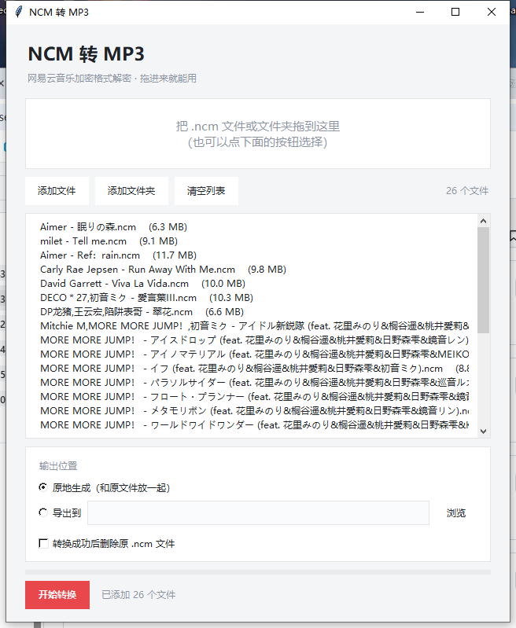
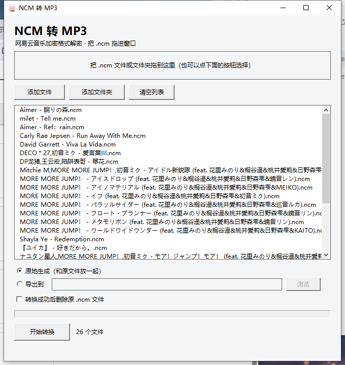

<div align="center">
  

  # NCM 转 MP3

  **网易云音乐加密格式解密工具** · 图形界面 · 拖拽即用

  <a href="../../releases/latest"><strong>下载程序</strong></a>
  ·
  <a href="py/ncm_gui.py">Python 源码</a>
  ·
  <a href="c/ncm2mp3_gui.c">C 源码</a>
  ·
  <a href="docs/原理说明.md">原理说明</a>
</div>

<br />

把网易云音乐的 `.ncm` 文件还原成普通 `.mp3` / `.flac`。本地解密，不联网，不上传。

提供 **Python 版** 和 **C 版** 两个实现，功能一致，输出结果逐字节相同。

## 界面

| Python 版 | C 版 |
| :---: | :---: |
|  |  |

## 两个版本怎么选

| | Python 版 | C 版 |
| :--- | :--- | :--- |
| 体积 | 15.9 MB | **0.3 MB** |
| 界面 | 图形界面 | 图形界面 |
| 拖拽 | 拖进窗口 | 拖进窗口 |
| 批量 | 支持 | 支持 |
| 依赖 | 打包了 Python 运行时 | 无（只用系统 API） |
| 启动速度 | 较慢（要解压） | 快 |

**只想用：** 随便挑一个，功能一样。
**想要轻量：** C 版，300 KB，拷到哪都能跑。
**想改代码：** Python 版更好读，C 版更适合学习 Win32。

## 功能

- **拖拽即用**：文件或文件夹直接拖进窗口
- **批量转换**：一次处理几十上百个，带进度条
- **两种输出**：原地生成，或导出到指定文件夹
- **可选删除源文件**：转换成功后自动清理 `.ncm`
- **无损还原**：直接还原原始音频字节，不重编码

## 使用方法

1. 打开程序
2. 把 `.ncm` 文件或文件夹**拖进窗口**
3. 选输出位置（原地 / 导出到）
4. 需要的话勾上「转换成功后删除原 .ncm 文件」
5. 点「开始转换」

> 也可以把文件拖到 exe 图标上启动，程序会自动加载。

## 原理

`.ncm` 的结构是「固定魔数 + AES 加密的 RC4 密钥 + 变形 RC4 加密的音频」：

```
CTENFDAM | 密钥(AES-128-ECB) | 元数据 | CRC | 封面图 | 音频(异或流)
```

完整推导过程见 [`docs/原理说明.md`](docs/原理说明.md)，包括密钥推导、KSA/PRGA 细节和常见坑。

## 目录结构

```
ncm2mp3/
├── py/                     Python 版
│   ├── ncm_gui.py          图形界面
│   ├── ncm_core.py         解密核心
│   ├── ncm2mp3-cli.py      命令行版
│   ├── make_icon.py        图标生成
│   └── build.bat           打包脚本
├── c/                      C 版
│   ├── ncm2mp3_gui.c       Win32 图形界面
│   ├── ncm2mp3.c           命令行版
│   ├── ncm2mp3_gui.rc      图标资源
│   └── build-c.bat         编译脚本
├── docs/                   截图与原理说明
├── icon.ico                程序图标
└── dist/                   编译产物
```

## 自己编译

**Python 版**

```bash
pip install cryptography tkinterdnd2 pyinstaller
pyinstaller --onefile --windowed --name NCM转MP3 \
  --icon icon.ico --collect-all tkinterdnd2 py/ncm_gui.py
```

**C 版**

需要 Visual Studio 2022（含 C++ 桌面开发）：

```bat
cd c && build-c.bat
```

或手动：

```bat
rc /fo ncm2mp3_gui.res ncm2mp3_gui.rc
cl /O2 /utf-8 ncm2mp3_gui.c ncm2mp3_gui.res bcrypt.lib comctl32.lib shell32.lib ole32.lib user32.lib gdi32.lib comdlg32.lib
```

## 常见问题

**解出来是乱码 / 打不开**

文件损坏或不是真正的 ncm。正常文件解密后应以 `ID3`（mp3）或 `fLaC` 开头。

**能转成 mp4 吗**

不能。`.ncm` 里装的是**音频**，不是视频。要视频得用 ffmpeg 把音频和封面合成。

**会不会泄露账号**

不会。全程本地解密，不联网、不上传。

## 免责声明

仅供转换**自己合法获取**的音乐文件，请勿用于传播盗版内容。

## License

[MIT](LICENSE)
