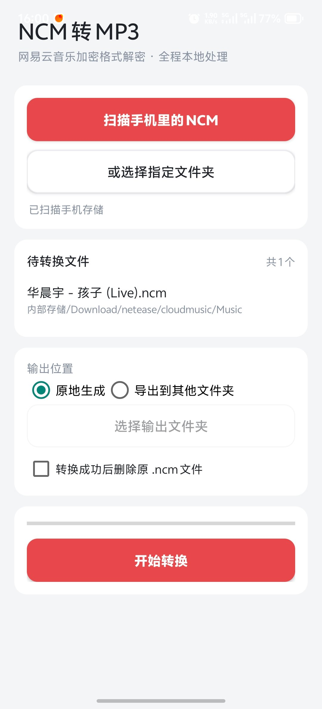

<div align="center">
  

  # NCM 转 MP3

  **网易云音乐加密格式解密** · Windows + Android · 全程本地处理

  <a href="../../releases/latest"><strong>下载程序</strong></a>
  ·
  <a href="py/ncm_gui.py">Python 源码</a>
  ·
  <a href="c/ncm2mp3_gui.c">C 源码</a>
  ·
  <a href="android/src/com/keke/ncm2mp3/MainActivity.java">Android 源码</a>
  ·
  <a href="docs/原理说明.md">原理说明</a>
</div>

<br />

把网易云音乐的 `.ncm` 文件还原成普通 `.mp3` / `.flac`，支持 Windows 桌面和 Android 手机。

提供三种实现，解密算法完全一致，**输出文件逐字节相同**。

## 界面

| Windows | Android |
| :---: | :---: |
|  |  |

## 下载

| 文件 | 平台 | 大小 | 说明 |
| :--- | :--- | :--- | :--- |
| [NCM2MP3-C.exe](../../releases/download/v1.1.0/NCM2MP3-C.exe) | Windows | 0.3 MB | 原生 Win32，无依赖，推荐 |
| [NCM2MP3-Python.exe](../../releases/download/v1.1.0/NCM2MP3-Python.exe) | Windows | 15.9 MB | Python 打包，功能相同 |
| [NCM2MP3-Android.apk](../../releases/download/v1.1.0/NCM2MP3-Android.apk) | Android 7.0+ | 0.13 MB | 支持全盘扫描 |

<sub>全部版本见 [Releases](../../releases) · 程序未签名，首次运行如遇 SmartScreen 请点「更多信息 → 仍要运行」</sub>

## 三个版本怎么选

| | Python 版 | C 版 | Android 版 |
| :--- | :--- | :--- | :--- |
| 平台 | Windows | Windows | Android 7.0+ |
| 体积 | 15.9 MB | **0.3 MB** | **0.13 MB** |
| 界面 | 图形界面 | 图形界面 | 手机界面 |
| 拖拽 | 拖进窗口 | 拖进窗口 | 拖入不适用 |
| 批量 | 支持 | 支持 | 支持 |
| 扫描文件 | 手动添加 | 手动添加 | **全盘扫描** |
| 依赖 | 打包 Python 运行时 | 无 | 无 |

Windows 端两个版本功能完全一样，只是体积和依赖不同。

## 功能

- **批量转换**：一次处理几十上百个，带进度条
- **两种输出**：原地生成，或导出到指定文件夹
- **可选删除源文件**：转换成功后自动清理 `.ncm`
- **无损还原**：直接还原原始音频字节，不重编码
- **手机端**：一键扫描全盘 `.ncm`，不用手动找目录

## Windows 使用方法

### 方案一：直接拖到程序图标上

把 `.ncm` 文件（或装着 `.ncm` 的文件夹）直接拖到 `NCM2MP3-C.exe` 或 `NCM2MP3-Python.exe` 的图标上。

程序会自动打开并把这些文件载入列表，再点「开始转换」就行。

适合一次性处理几个文件，省去手动添加这一步。

### 方案二：打开程序后添加

**第一步：打开程序**

双击 `NCM2MP3-C.exe` 或 `NCM2MP3-Python.exe`。

**第二步：添加文件**

把 `.ncm` 文件（或装着 `.ncm` 的文件夹）拖进窗口上方的拖放区。
也可以点「添加文件」一次多选，或点「添加文件夹」把整个目录导进来。

**第三步：选择输出位置**

- **原地生成**（默认）：转换结果和源文件放在同一个文件夹
- **导出到**：点「浏览」指定另一个文件夹，所有结果统一放进去

**第四步：决定是否删除源文件**

勾选「转换成功后删除原 .ncm 文件」，转换完成时源文件会被一并清理；
不勾选则保留，方便自己核对结果。

**第五步：开始转换**

点「开始转换」，进度条走完后弹出结果。列表中每个文件后面会标 ✓ 或 ✗。

## Android 使用方法

**第一步：安装**

把 `NCM2MP3-Android.apk` 传到手机，点开安装。提示「未知来源」时选择允许。

**第二步：授予权限**（首次扫描时）

点「扫描手机里的 NCM」，会跳到系统设置。
打开「允许访问所有文件」开关，返回程序后自动开始扫描。

> 不授权也能用：点「或选择指定文件夹」，用系统的文件夹选择器挑一个目录。

**第三步：确认文件列表**

扫描完成后会列出找到的所有 `.ncm`，每行显示文件名和所在目录。

**第四步：选择输出位置**

- **原地生成**：mp3 写在 ncm 同一个文件夹
- **导出到其他文件夹**：点按钮另选目标目录

**第五步：开始转换**

点「开始转换」，进度条走完，每行右侧显示 ✓ 或 ✗。

## 原理

`.ncm` 的结构是「固定魔数 + AES 加密的 RC4 密钥 + 变形 RC4 加密的音频」：

```
CTENFDAM | 密钥(AES-128-ECB) | 元数据 | CRC | 封面图 | 音频(异或流)
```

完整推导过程见 [`docs/原理说明.md`](docs/原理说明.md)，包括密钥推导、KSA/PRGA 细节和常见坑。

## 目录结构

```
ncm2mp3/
├── py/                     Windows · Python 版
│   ├── ncm_gui.py          图形界面
│   ├── ncm_core.py         解密核心
│   ├── ncm2mp3-cli.py      命令行版
│   └── build.bat           打包脚本
├── c/                      Windows · C 版
│   ├── ncm2mp3_gui.c       Win32 图形界面
│   ├── ncm2mp3.c           命令行版
│   ├── ncm2mp3_gui.rc      图标资源
│   └── build-c.bat         编译脚本
├── android/                Android 版
│   ├── src/.../MainActivity.java
│   ├── AndroidManifest.xml
│   ├── res/                图标与字符串
│   └── build_apk.ps1       打包脚本
├── docs/                   截图与原理说明
├── icon.ico / icon.png     程序图标
└── dist/                   编译产物
```

## 自己编译

**Python 版**

```bash
pip install cryptography tkinterdnd2 pyinstaller
pyinstaller --onefile --windowed --name NCM转MP3 \
  --icon icon.ico --collect-all tkinterdnd2 py/ncm_gui.py
```

**C 版**（需要 Visual Studio 2022）

```bat
cd c && build-c.bat
```

**Android 版**（需要 Android SDK + JDK）

```powershell
cd android
powershell -File build_apk.ps1
```

## 常见问题

**解出来是乱码 / 打不开**

文件损坏或不是真正的 `.ncm`。正常文件解密后应以 `ID3`（mp3）或 `fLaC` 开头。

**能转成 mp4 吗**

不能。`.ncm` 里装的是**音频**，不是视频。要视频得用 ffmpeg 把音频和封面合成。

**手机上点扫描没反应**

系统设置 → 应用 → NCM 转 MP3 → 权限 → 所有文件访问 → 允许。

**会不会泄露账号**

不会。三个版本都是本地解密，不联网、不上传。

## 免责声明

仅供转换**自己合法获取**的音乐文件，请勿用于传播盗版内容。

## License

[MIT](LICENSE)
